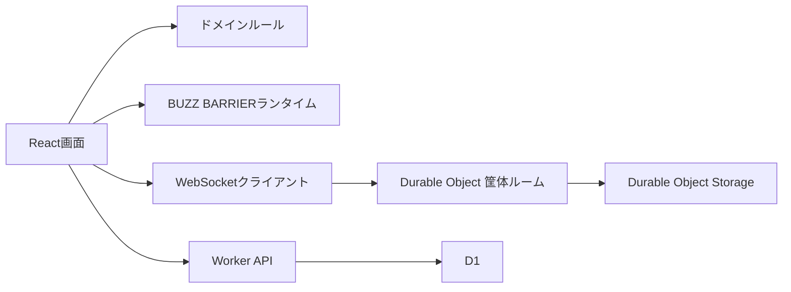
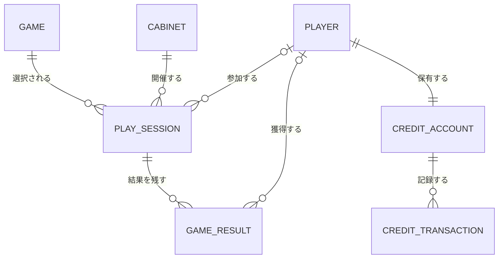

# アーキテクチャ

## 方針

ゲームセンターと個別ゲームを別の境界として扱います。プラットフォーム側はゲーム選択、筐体、プレイヤー、観戦、クレジット、結果を管理し、個別ゲーム側はゲームルールと描画を担当します。

## 概念モデル

- **ゲーム**: プラットフォームに登録された遊戯単位
- **筐体**: URLで共有されるリアルタイムルーム。現在はDurable Objectが状態を保持
- **プレイヤー**: ゲストまたは登録ユーザー。登録時にゲストの残高を引き継ぐ
- **プレイセッション**: 筐体で始まる1回のソロ・対戦・協力プレイ
- **ゲーム結果**: クリア時間、スコア、レベル、勝敗などの不変記録
- **クレジット口座・取引**: 無料・購入残高と予約・消費・返却の履歴
- **ランキング**: ゲーム結果を並べた読み取りモデル。独立した永続エンティティにはしない

## フロントエンド

- `ArcadeScreen`: ゲームセンタートップとゲーム一覧
- `CabinetScreen`: 個別筐体の状態、共有URL、着席・観戦への入口
- `GameScreen`: プレイ・観戦共通のゲーム表示領域
- `src/domain`: UIや通信に依存しない状態遷移
- `src/realtime`: 通信形式と再接続
- `src/games/graze-duel`: BUZZ BARRIER固有実装
- `src/games/deep-sea-salvage`: 深海サルベージ固有実装
- `src/games/dot-wave`: DOT WAVE固有実装
- `src/game-sdk`: ゲームの起動・破棄、プレイ開始契約、筐体セッション

### 起動と終了

`App` はトップ、ゲーム選択、筐体URLを振り分けます。トップとゲーム選択ではゲームランタイムを起動しません。`games/registry.ts` はCanvas型またはReact型のゲーム入口を登録し、筐体へ入ったときだけ遅延ロードします。

Canvas型は `mountGame(GameContext): GameInstance` を公開します。モジュール読み込み自体ではイベント登録や描画を始めず、訪問ごとに新しいインスタンスを生成します。`GameLifetime` にイベント、描画フレーム、タイマー、通信、描画リソースを登録し、画面を離れる際に一括破棄します。React型はコンポーネントとコントローラのcleanupで同じ責務を果たします。

`GameHost` は現在のゲームに `start` / `retry` を渡します。クレジット確認はDOMボタンの再クリックや画面表示の推測ではなく、型付きの開始要求と開始結果で連携します。ゲームが切り替わった後に古い開始処理が完了しても成功扱いにしません。

### 責務の分割

- 深海サルベージ: `state.ts` が状態、`simulation.ts` が進行・判定、`renderer.ts` とThree.js層が描画、`runtime.ts` が入力・画面・同期の調停を担当
- BUZZ BARRIER: `state.js` が初期状態、`simulation.js` が移動・状態更新、`input.js` がキーボード・タッチ、`core.ts` が純粋ルール、`rendering/canvas-renderer.js` が描画、`audio.ts` がインスタンス単位の音声、互換ランタイムが弾幕・ボス進行と同期を調停
- DOT WAVE: `engine.ts` がゲーム状態、`cabinetController.ts` が通信と開始処理、`useDotWaveCabinet.ts` がReactへの橋渡し、各コンポーネントが表示を担当
- 共通画面: `games/ui-registry.tsx` の表示スロットにゲーム固有UIを登録し、`GameScreen` の条件分岐を増やさない
- プラットフォーム: プロフィール、ユーザー登録、規約、無料クレジット、購入を個別コンポーネントに分割。ユーザーと購入の非同期処理は専用フック、プレイ時の予約・開始・消費・失敗時返却は `play-service.ts` が担当

既存CanvasのDOM描画やゲーム別リアルタイムプロトコルは互換境界として残します。共通化は責務の一致する部分に限定し、ゲームごとの進行・勝敗・音楽同期まで共通エンジンに押し込めません。

ゲームの表示名、説明、アセット、クレジット数、バージョンは `src/domain/game.ts` のゲームカタログへ集約します。ゲーム固有ランタイムは `src/games/registry.ts` に遅延ロード関数を登録します。画面、筐体通信、クレジット予約、ランキングは `gameId` を受け取り、個別ゲーム名を直接参照しません。

新しいゲームを追加する際は、最低限以下を行います。

1. `GAME_CATALOG` にゲーム定義を追加する
2. `src/games/registry.ts` にランタイムローダーを追加する
3. Canvas型の `mountGame` またはReact型の `Component` を実装し、共通筐体セッション、結果APIと接続する
4. `games` テーブルへ同じ `gameId` を追加するマイグレーションを用意する
5. ソロ、観戦、ランキング、クレジット予約の契約テストを追加する

既存の筐体URL `/cabinets/:cabinetId` は維持し、`game` クエリでゲームを識別します。クエリがない過去URLは既定ゲームへフォールバックします。

BUZZ BARRIERの既存Canvas処理は挙動を壊さないため `legacy-runtime.js` に隔離しています。新しい画面、ドメイン、通信、APIはTypeScriptで実装し、ゲーム固有処理を変更する際は `core.ts`、`audio.ts` などへ段階的に移します。この互換層からプラットフォーム機能を増やさないことをルールとします。

## リアルタイム通信

筐体IDごとにDurable Objectを1つ割り当てます。最初の接続者をプレイヤー、後続を観戦者として扱います。

- プレイヤーは弾生成イベント、位置更新、定期キーフレームを送信
- 観戦側は速度からローカル描画し、キーフレームで差分補正
- Durable Objectは最新状態を保持し、途中参加者へ再送
- Hibernation WebSocket APIでアイドル時の実行コストを抑制
- 観戦者からのゲーム操作メッセージは受理しない

対戦実装では、同じ筐体状態機械に `challengePending`、`versusReady`、`versusPlaying`、`result` を追加済みの状態として接続します。

### 深海サルベージのライブ観戦

- 筐体選択時は観戦接続のみ行い、クレジットによるゲーム開始時にプレイヤーとして着席する
- 共有URLの `watch=1` は、ゲーム開始前やプレイヤー離脱後も観戦専用の待機画面を表示する
- プレイヤーは潜水艇・魚・ボス・HUD・演出の状態を毎秒15回配信する
- 地形コースと障害物は開始時と毎秒1回のキーフレームで同期する
- 観戦側は直近2フレームの位置を補間して、共通の2D/Three.js描画を使う。ゲーム進行・判定・魚の生成は実行しない
- パケット順序は連番で確認し、新しいプレイ開始やプレイヤー離脱で補間状態をリセットする
- 観戦にはクレジットを使わず、プレイ操作・ランキング登録は表示しない
- ゲーム終了後はプレイヤーの選択待ちを表示し、離脱時は映像をクリアする
- プレイ中筐体一覧からの画面内遷移、途中参加、再接続でも同じ筐体へ接続する

## データ

D1には以下を保持します。

- `games`
- `players`
- `play_sessions`
- `game_results`
- `credit_accounts`
- `credit_transactions`
- `rankings`（既存API互換。将来は `game_results` からの読み取りへ移行）

ゲーム中の高頻度な位置や弾情報はD1に保存せず、Durable ObjectとWebSocketだけで扱います。

## Cloudflare境界

`src/worker/index.ts` が唯一のWorker入口です。

- `/api/cabinets/:id/ws`: Durable Objectへ転送
- `/api/ranking`: D1ランキングAPI
- `/api/health`: 動作確認
- その他: Workers Static Assets

本番だけBasic認証を有効にし、認証情報はWorker Secretで管理します。ローカルおよび同一LANのプライベートIPは開発確認のため認証対象外です。
